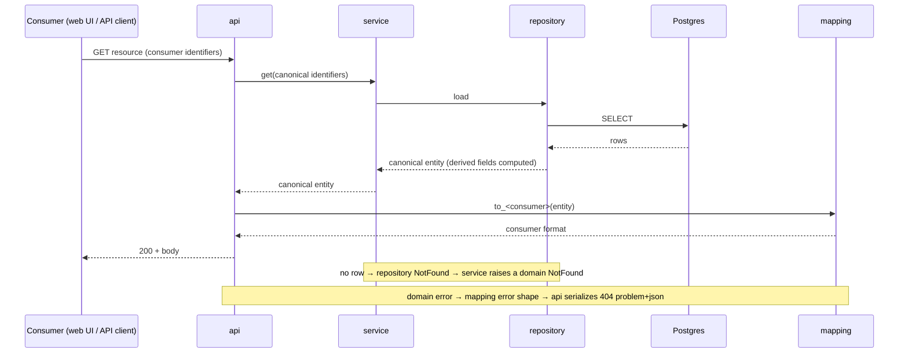
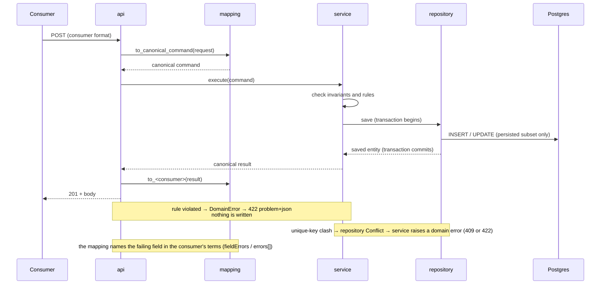
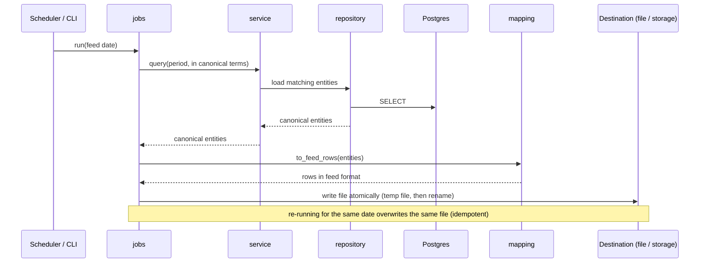

> Source: znectAI standards v1, patterns/python-fastapi.md. Do not edit here:
> amend it with a project ADR, or change the standard.

# Pattern catalogue — Python / FastAPI stack

> Platform standard (znectAI standards v1). A project copies this file to
> `specs/architecture/patterns.md` and fills in its own reference implementation for each
> pattern as its first use case of that pattern is built. The references below are from
> reference-orders, the platform's reference app.

Every use case follows one of these patterns, or a combination. A use case names its
pattern(s) and describes only what is specific to it. Participants are the layers from the
project's `overview.md`; the same names are enforced by the layering check. Each pattern
links to its **reference implementation**: copy it.

Mapping and errors follow P-ADR-006: mapping happens at the interface where the
representation changes (consumer ↔ api, repository ↔ database, integrations ↔ external
system), and each layer raises only its own errors. The notes under each diagram show the
error path: a repository error becomes a domain error in the service, and the mapping turns
domain errors into the consumer's error shape before the api serializes it.

---

## P1 Query

Read canonical data and return it in a consumer's format. No writes, no transaction beyond a
read.

Reference implementation (reference-orders): **UC-002 View order** — `app/api/web_bff.py:get_order`,
`app/service/orders.py:get_order`, `app/mapping/web_ui.py:order_detail_view`.



## P2 Command

Change state under domain rules, in one transaction.

Reference implementation (reference-orders): **UC-001 Create order** — `app/api/web_bff.py:create_order`,
`app/mapping/web_ui.py:create_order_command`, `app/service/orders.py:create_order`.



## P3 Outbound integration

Send canonical data to an external system in its format. Never inside the domain
transaction; safe to repeat.

Reference implementation (reference-orders): **UC-004 Send order to warehouse** —
`app/service/fulfilment.py:send_to_warehouse`, `app/integrations/warehouse.py`,
`app/mapping/warehouse.py:outbound_order`.

```mermaid
sequenceDiagram
  participant S as service
  participant I as integrations
  participant M as mapping
  participant X as External system
  participant R as repository
  S->>I: send(canonical entity)
  I->>M: to_partner(entity)
  M-->>I: partner payload
  I->>X: POST payload + Idempotency-Key (stable per entity)
  alt accepted
    X-->>I: 2xx + partner reference
    I-->>S: partner reference
    S->>R: record reference + status change (own transaction)
  else timeout / 5xx
    X-->>I: error
    I-->>S: TemporaryFailure (after bounded retries)
    S->>S: leave state unchanged; retry job picks it up later
  else 4xx
    X-->>I: rejected
    I-->>S: PermanentFailure
    S->>R: record failure for a human (no retry)
  end
```

## P4 Inbound integration

Accept a call from an external system, in its format, and apply it to canonical state.

Reference implementation (reference-orders): **UC-005 Receive shipment update** —
`app/api/warehouse_webhook.py`, `app/mapping/warehouse.py:inbound_event`,
`app/service/fulfilment.py:apply_shipment_event`.

```mermaid
sequenceDiagram
  participant X as External system
  participant A as api
  participant M as mapping
  participant S as service
  participant R as repository
  X->>A: POST event (partner format) + signature
  A->>A: verify signature (401 if invalid)
  A->>M: to_canonical(event)
  M-->>A: canonical event
  A->>S: apply(event)
  S->>S: check transition is allowed
  S->>R: save status change (transaction)
  S-->>A: applied | duplicate
  A-->>X: 200 (also for duplicates: idempotent)
  Note over S,A: transition not allowed → 409; unknown reference → 404
```

## P5 Feed / export

Produce a file for a consumer on a schedule, from stored data.

Reference implementation (reference-orders): **UC-006 Daily orders feed** — `app/jobs/finance_feed.py`,
`app/service/orders.py:orders_placed_between`, `app/mapping/finance_feed.py`.



## P6 Async / event

Not defined yet. A project that needs it makes an architecture change (ADR required), and
the platform adds it here once a project has a reference implementation.
